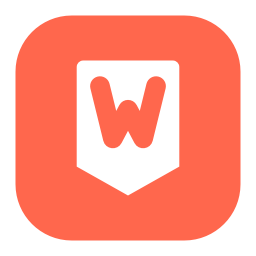

<p align="center"></p>

<h1 align="center">WordClip</h1>

<p align="center"><strong>隨手收集，慢慢掌握。</strong></p>

<p align="center"><a href="README.md">English</a> · <a href="README.zh-Hans.md">简体中文</a> · <strong>繁體中文</strong><br />
<a href="https://github.com/dofy/wordclip">GitHub</a> · <a href="https://github.com/dofy/wordclip/issues">Issues</a></p>

<p align="center">
  
  
  
  
  
</p>

[WordClip](https://wordclip.phpz.org/zh-Hant/) 是一款隨時隨地收集單字、離線查詢、間隔重複複習的跨平台單字學習工具。目前針對英語,架構上可以擴充到任何語言。

**平台**:macOS · iOS · iPadOS
**技術堆疊**:SwiftUI(跨平台單一程式碼庫)· SwiftData · Swift Package(`WordClipKit` 共用核心)· GRDB(離線詞庫)

## 已完成功能

### 收錄
- **macOS 全域收錄**:在任何 App 中選取單字,按快速鍵(預設 `⌥⌘C`)一鍵收錄,螢幕彈出 HUD 提示,不中斷目前的 App。透過輔助使用直接讀取選取的文字,不動剪貼板。
- **OCR 收錄(Pro)**:按快速鍵(預設 `⌥⌘O`)框選螢幕區域,由 Vision 辨識其中的單字,經內建字典驗證後彈出選字面板多選收錄。適用於圖片 / PDF / 無法選取的文字。
- **選單列圖像**:查看今日總覽、快速啟用或停用選取收錄、打開主視窗或設定;圖像亮或暗代表收錄功能是否啟用。
- **不佔 Dock**:`⌘W` 收起視窗時 Dock 圖示一起消失。WordClip 繼續在選單列執行,取詞快速鍵照常運作,重新打開時視窗和你離開時一樣。可在「設定 > 一般」關掉。
- **URL Scheme**:`wordclip://collect?word=<單字>`,可以從「捷徑」、腳本或其他 App 呼叫收錄。
- **iOS / iPadOS**:手動輸入,或從剪貼板貼上來新增單字。

### 單字包
- **兩類離線單字包**:分級包(初學者／學測指考／CET-4／CET-6／研究所／托福／雅思／GRE)與情境包(日常生活／旅遊休閒／技術英語／商務職場),全部免費離線。
- **資料夾式隔離**:匯入的單字與手動收錄的單字按分組隔離,複習與單字本都可以按分組篩選,只學某一包或選「全部」混著學。
- **可移除**:在單字本工具列把分組篩選到某個單字包,就能一鍵移除(刪掉這一包的單字與複習進度),之後仍可重新匯入。
- **入口**:詞庫是空的時候每次啟動都會引導,單字本與複習頁的工具列也可以隨時補匯入。

### 字典與查詢
- **內建離線詞庫**:ECDICT 精簡版約 5 萬字(音標加上中英釋義),以 GRDB SQLite 檔案隨 App 一起發佈。
- **詞形還原**:`brought → bring` 這類變化形自動還原成原形來查詢。
- **自訂字典匯入**:擴充查詢時的釋義**來源**,不會把單字加進單字本。支援 CSV 與 ECDICT 結構的 SQLite,多本依優先順序疊加,可以啟用、停用、刪除與排序;App 內含格式說明與準備指引。
- **釋義結構化**:依詞性分行、學科標記(`[计]`／`[化]`)以灰字呈現、中文與英英釋義分區顯示。哪一份當主釋義取決於介面語言。

### 單字本
- **三欄版面**(macOS / iPad):導覽 → 列表 → 詳細資訊。
- **搜尋**:單字本裡的相符單字優先,下方列出字典中還沒收錄的相符單字,點一下可以預覽並直接收錄。
- **分組篩選**:匯入單字包之後,工具列會出現分組選單,可以只看某個單字包、手動收錄,或全部。
- **排序**:依收錄時間、字母或熟悉度,會記住上次的選擇。
- 收藏、TTS 朗讀、釋義修復、刪除。
- **完整鍵盤快速鍵**(macOS,以及接鍵盤的 iPad):導覽切換、跳到搜尋、新增與刪除、朗讀、收藏等等。

### 複習
- **SM-2 間隔重複演算法**:翻卡看釋義,標記「認識／不認識」——認識會拉長下次間隔,不認識則重設回明天,複習排程自動安排。
- 翻面不可逆(避免誤觸)。學習時 `空白鍵` 翻面,`←` / `→` 評分。
- 單字本用標記區分「新字」與「待複習」。
- **本機通知**每天提醒複習。

### 統計與資料
- 統計面板:總字數、待複習、新字、精熟率。
- **JSON 備份匯入／匯出**:匯出你自己收錄的單字(單字包的單字可以重新匯入,所以不進備份)。匯入會依單字智慧合併,不會覆蓋已有的學習進度。

### 付費
- **WordClip Pro 付費牆**:單一「終身買斷」頁面(解鎖 OCR 收錄與字典匯入)。
- **功能閘門**:免費與 Pro 的界線一律走 `entitlement.isPro`。DEBUG 版用 `MockEntitlement`(設定頁有「模擬 Pro」開關),Release 版用真正的 `StoreKitEntitlement`,透過 `AppEntitlement` 別名切換。
- **StoreKit 2 App 內購買(已實作)**:`StoreKitEntitlement`(一次性、非消耗型)加上本機 `.storekit` 設定,在 Xcode 直接 Run 就能測試購買與回復,不需要付費帳號;上架還需要在 App Store Connect 設定商品並在實機驗證。
- **免費**:收錄、基本離線查詢、單字本、複習、統計、匯出。**Pro**:OCR 收錄、字典匯入。

### 其他
- **三語介面**:English / 简体中文 / 繁體中文(String Catalog,跟隨系統語言),介面語言與學習語言互相獨立。
- **iCloud 同步的預留介面**:設定頁的佔位開關;真正的同步是規劃中的功能,尚未實作。
- **`WordClipKit` 70 條單元測試**,涵蓋演算法、詞庫、匯入、統計、權益與單字包。

---

## 規劃中

> **收費政策(已定)**:一次性購買、終身買斷,不做訂閱。**WordClip Pro** 包含 OCR 收錄與字典匯入,以及規劃中的 iCloud 同步與線上字典。收錄與基本查詢永久免費。詳見 [PLAN.md](docs/PLAN.md#5-收费政策已定)。

- **iCloud 同步**:SwiftData + CloudKit 跨裝置同步。設定頁的介面已經就位,同步本身還要實作,也需要付費的 Apple Developer 帳號。
- **線上字典服務**:直接搜尋並匯入擴充字典,而不只是匯入本機檔案;本機 CSV / SQLite 匯入仍保留當後備。
- **iOS 分享擴充功能**:從系統分享選單收錄。
- **更多複習模式**:中翻英拼寫、聽音辨義等等。目前只有翻卡的認識／不認識。
- **AI 加強**:釋義、例句、字根講解。`AIProvider` 協定已預留,目前是佔位實作。
- **其他學習語言**,例如日語。收錄邏輯目前假設是英語。

---

## 文件

- [使用說明](HELP.zh-Hant.md) — 用法、快速鍵、字典匯入、URL scheme
- [開發進度](docs/PROGRESS.md) — 已完成功能與後續計畫
- [開發計畫](docs/PLAN.md) — 產品目標、功能邊界、收費方案
- [架構與關鍵技術決策](docs/ARCHITECTURE.md)
- [官方網站](https://wordclip.phpz.org/zh-Hant/)

## 開發環境

- macOS 加上**完整版 Xcode**——只裝 Command Line Tools 無法建置 App
- `brew install xcodegen`。`*.xcodeproj` 不入庫,複製 repo 之後要執行 `xcodegen generate`
- 實機除錯與發佈需要 Apple Developer 帳號

## 發佈路線

- **iOS / iPadOS**:上 App Store。見 [RELEASE-iOS.md](docs/RELEASE-iOS.md)。
- **macOS**:Developer ID 加公證,從網站發佈——**不上 Mac App Store**,因為沙盒禁止讀取其他 App 選取的文字,那會讓我們失去原生的全域收錄。詳見 [ARCHITECTURE §3.1](docs/ARCHITECTURE.md) 與 [PLAN](docs/PLAN.md)。

```bash
./scripts/package-release.sh          # → dist/WordClip-<版本>.dmg
```

腳本會建置 Release Apple Silicon（`arm64`）二進位檔、簽名,並打出一個 DMG:App、`Applications` 符號連結,
以及一份三語的第一次執行說明(Gatekeeper、輔助使用、螢幕錄製)。

**這個建置裡 Pro 是解鎖的。** 直接發佈的副本拿不到 App Store 收據,
`StoreKitEntitlement` 會永遠判定未購買,OCR 取詞和字典匯入會被鎖在付費牆後面,而付費
牆也沒有能完成的交易。該建置定義 `WORDCLIP_DIRECT_DISTRIBUTION`,改用
`UnlockedEntitlement`;旗標萬一沒生效,腳本會直接失敗,而不是發出一個功能被鎖死的包。
App Store 建置是**不帶**這個旗標的那個,不受影響。

簽名預設用自簽名憑證 `WordClip Distribution`,所以 macOS 第一次啟動會擋一次,收到的人
在系統設定裡批准一次即可。要備份這張憑證並且之後每次建置都用它,否則 macOS 不再把新
版本認作同一個 app,所有人的輔助使用授權都要重新授予。有 Apple 開發者帳號時改傳真實
身分,警告就不會出現:

```bash
SIGNING_IDENTITY="Developer ID Application: 名字 (TEAMID)" \
  ./scripts/package-release.sh
```

這條路徑還會打開強化執行階段和安全時間戳記,公證需要這兩樣。公證本身
(`xcrun notarytool submit` 與 `stapler staple`)還沒接。

